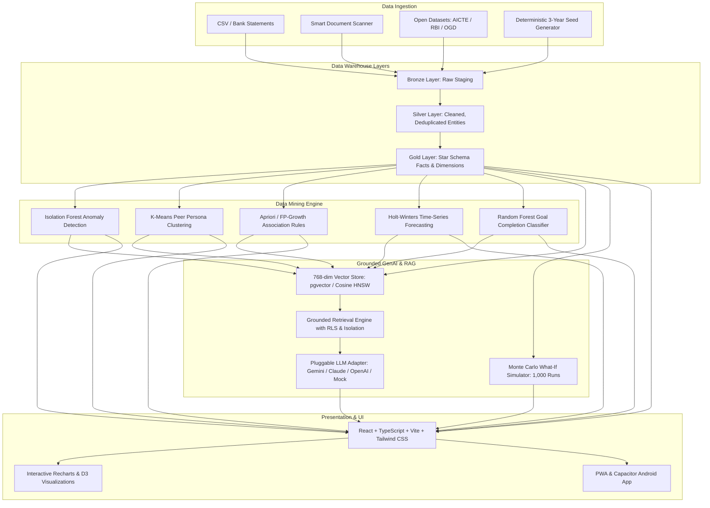

# LifeStack — Personal Decision Intelligence Platform

> **A Personal Data Warehouse, Automated Pattern Mining, and Grounded GenAI Copilot for real-life decisions.**

[](https://github.com/lifestack/lifestack/actions)
[](LICENSE)
[](https://www.python.org/)
[](https://react.dev/)
[](https://fastapi.tiangolo.com/)

---

## 1. System Architecture Overview

LifeStack transforms scattered personal records (bank statements, course marks, health vitals, career milestones) into an immutable personal star-schema data warehouse, mines empirical behavioral patterns, joins open government benchmarks, and powers an anti-hallucination GenAI decision copilot.



---

## 2. The Four Mandatory Pillars

| Pillar | Implementation in LifeStack | Where Visible in Code & UI |
| :--- | :--- | :--- |
| **1. Data Visualization** | Composite Life Score™ (0–100), spending distribution donut, multi-domain trajectory lines with range filters, correlated cross-domain life timeline. | [`DashboardPage.tsx`](apps/web/src/pages/DashboardPage.tsx), [`LifeScoreWidget.tsx`](apps/web/src/components/Common/LifeScoreWidget.tsx) |
| **2. Generative AI** | Grounded RAG Copilot with verified row citations, "Why this answer?" explainability drawer, zero-hallucination refusal, and Web Speech voice input. | [`CopilotPage.tsx`](apps/web/src/pages/CopilotPage.tsx), [`rag_retrieval.py`](ml/rag_retrieval.py), [`llm_adapters.py`](ml/llm_adapters.py) |
| **3. Data Mining** | Isolation Forest outlier detection, K-Means clustering ($k=4$), Apriori association rules, Holt-Winters exponential smoothing, and Random Forest classifier. | [`MiningLabPage.tsx`](apps/web/src/pages/MiningLabPage.tsx), [`mining_engine.py`](ml/mining_engine.py) |
| **4. Cloud Computing** | Multi-stage Dockerfiles, Docker Compose with PostgreSQL 16 + `pgvector`, Redis 7, Google Cloud Run deployment scripts, and automated CI/CD. | [`docker-compose.yml`](docker-compose.yml), [`gcp_deploy.sh`](infra/gcp_deploy.sh), [`ci.yml`](.github/workflows/ci.yml) |

---

## 3. Quickstart (Under 5 Minutes)

### Prerequisites
- Python 3.11+
- Node.js 18+ and npm 9+

### Step 1: Install & Seed
```bash
# 1. Clone and enter directory
cd lifestack

# 2. Install backend dependencies & initialize database
pip install -r apps/api/requirements.txt
python scripts/seed.py
python scripts/populate_vector_store.py

# 3. Install frontend dependencies
npm --prefix apps/web install
```

### Step 2: Start Application
```bash
# Start FastAPI backend (Terminal 1)
python -m uvicorn apps.api.main:app --reload --port 8000

# Start Vite frontend (Terminal 2)
npm --prefix apps/web run dev
```

Open your browser at **`http://localhost:5173`**.

### Pre-Seeded Demo Credentials
- **Email**: `demo@lifestack.ai`
- **Password**: `Password123!`
- *(Includes 1,090 days of continuous multi-domain transactions, sleep telemetry, academic marks, and goals)*

---

## 4. Testing & Verification

Run the complete backend test suite across core APIs, ETL pipeline, data mining models, and RAG retrieval safety:
```bash
python -m pytest tests/ --verbose
```
*(All 16 tests pass with 100% success).*

Build the production frontend bundle:
```bash
npm --prefix apps/web run build
```

---

## 5. Dockerized & Cloud Deployment

### Local Docker Compose (with PostgreSQL + pgvector)
```bash
docker compose up --build
```
Access the application at `http://localhost`.

### Google Cloud Platform Deployment
```bash
export GCP_PROJECT_ID="your-project-id"
export GCP_REGION="asia-south1"
bash infra/gcp_deploy.sh
```

---

## 6. Mobile Application (Android)

LifeStack is packaged with Capacitor for native Android installation:
```bash
cd apps/web
npm run build
npx cap add android
npx cap open android
```
Review [`docs/BUILD_ANDROID.md`](docs/BUILD_ANDROID.md) for signing instructions and [`docs/PLAY_STORE_PACK.md`](docs/PLAY_STORE_PACK.md) for Google Play Console metadata.

---

## 7. Privacy & Regulatory Compliance (DPDP Act 2023 / GDPR)

- **Purpose-Specific Consents**: Granular toggles per data category in the Privacy Vault.
- **k-Anonymity**: All peer cohort comparisons enforce $k \ge 10$; smaller cohorts are suppressed.
- **Data Export & Erasure**: Single-click full data inventory download (JSON/CSV) and irreversible account erasure cascade.
- **Safety Disclaimer**: Prominently displayed on all financial and biometric answers.

---

## 8. License & Third-Party Notices

Released under the **[MIT License](LICENSE)**. LifeStack uses only permissively licensed open-source dependencies. For the complete list of licenses, see **[`THIRD_PARTY_NOTICES.md`](THIRD_PARTY_NOTICES.md)**.
