# LifeStack Entity-Relationship (ER) Diagram

This document illustrates the complete Star-Schema data model of the LifeStack personal data warehouse, including dimension tables, fact tables, public reference datasets, and system/vector intelligence tables.

```mermaid
erDiagram
    dim_user ||--o{ fact_spending : "records"
    dim_user ||--o{ fact_health : "tracks"
    dim_user ||--o{ fact_academic : "enrolls"
    dim_user ||--o{ fact_career : "achieves"
    dim_user ||--o{ fact_goal_progress : "sets"
    dim_user ||--o{ fact_decision : "evaluates"
    dim_user ||--o{ consents : "grants"
    dim_user ||--o{ insights : "receives"
    dim_user ||--o{ alerts : "notified"

    dim_time ||--o{ fact_spending : "occurred_at"
    dim_time ||--o{ fact_health : "logged_on"
    dim_category ||--o{ fact_spending : "categorized_by"
    dim_source ||--o{ fact_spending : "ingested_via"

    dim_user {
        string user_id PK
        string email UK
        string full_name
        string hashed_password
        string role
        string demographic_cohort
        int persona_cluster
        boolean is_active
        datetime created_at
    }

    dim_time {
        int date_key PK
        date full_date UK
        int day_of_week
        string day_name
        int week_number
        int month_number
        string month_name
        int quarter
        int year
        boolean is_weekend
        boolean is_holiday
    }

    dim_category {
        string category_id PK
        string domain
        string name
        string parent_category
        boolean is_essential
    }

    dim_source {
        string source_id PK
        string source_name
        string source_type
        float reliability_score
    }

    dim_region {
        string region_id PK
        string city
        string state
        string tier
        float cost_of_living_index
    }

    fact_spending {
        string spending_id PK
        string user_id FK
        int date_key FK
        date date
        float amount
        string category_id FK
        string category_name
        string merchant
        string payment_method
        string source_id FK
        boolean is_anomaly
        boolean is_synthetic
        string notes
    }

    fact_health {
        string health_id PK
        string user_id FK
        int date_key FK
        date date
        float sleep_hours
        int steps
        int heart_rate_avg
        float stress_score
        float mood_score
        float water_liters
        float screen_time_hours
        boolean is_anomaly
        boolean is_synthetic
    }

    fact_academic {
        string academic_id PK
        string user_id FK
        int semester
        string course_name
        string course_code
        int credits
        float grade_point
        float attendance_pct
        float study_hours_wk
        boolean is_synthetic
    }

    fact_career {
        string career_id PK
        string user_id FK
        date date
        string role_title
        string company_tier
        float salary_inr
        float monthly_inhand
        int applications_sent
        int interviews_count
        int offers_count
        string skills_acquired
        boolean is_synthetic
    }

    fact_goal_progress {
        string goal_id PK
        string user_id FK
        string domain
        string title
        text description
        float target_amount_or_metric
        float current_amount_or_metric
        date target_date
        float progress_pct
        string status
        float monthly_savings_allocated
        boolean is_synthetic
    }

    fact_decision {
        string decision_id PK
        string user_id FK
        date date
        string category
        string title
        text details
        json options_considered
        string chosen_option
        text predicted_outcome
        float confidence_score
        text actual_outcome
        float outcome_score
        date review_scheduled_date
        string status
    }

    public_job_trends {
        string trend_id PK
        string role_title
        string domain
        float average_salary_inr
        float yoy_growth_pct
        float open_positions_index
        json required_skills
        float tier_1_city_demand
    }

    public_education_stats {
        string stat_id PK
        string course_branch
        string tier
        float average_placement_rate
        float median_package_lpa
        json top_recruiters
        float roi_index
    }

    public_market_data {
        string market_id PK
        date date
        float inflation_cpi
        float repo_rate
        float edu_loan_rate_avg
        float fd_rate_avg
        float equity_benchmark_return
    }

    doc_chunks {
        int chunk_id PK
        string user_id FK
        string source_type
        string source_ref
        text content
        json metadata_json
        json embedding_data
        datetime created_at
    }

    consents {
        string consent_id PK
        string user_id FK
        string category
        boolean consent_granted
        string purpose
        datetime granted_at
        datetime updated_at
    }

    audit_log {
        string log_id PK
        string user_id
        string action
        string resource
        json details
        string ip_address
        datetime timestamp
    }
```

